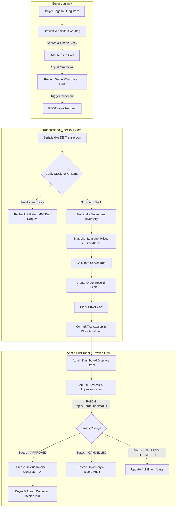
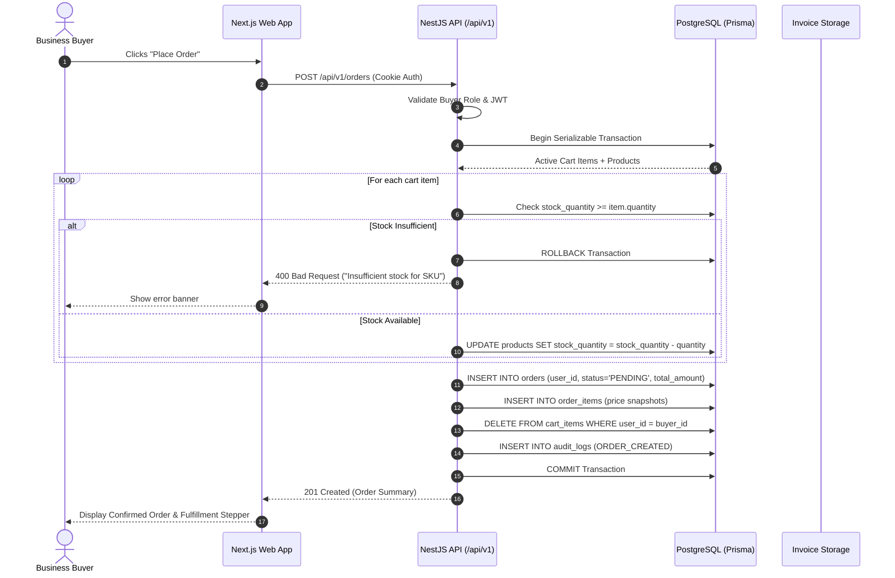
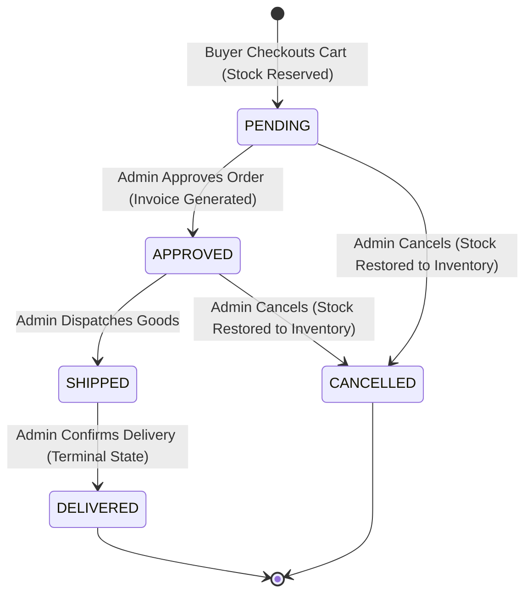
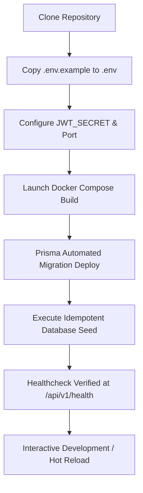
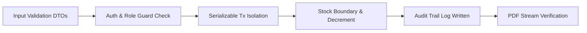
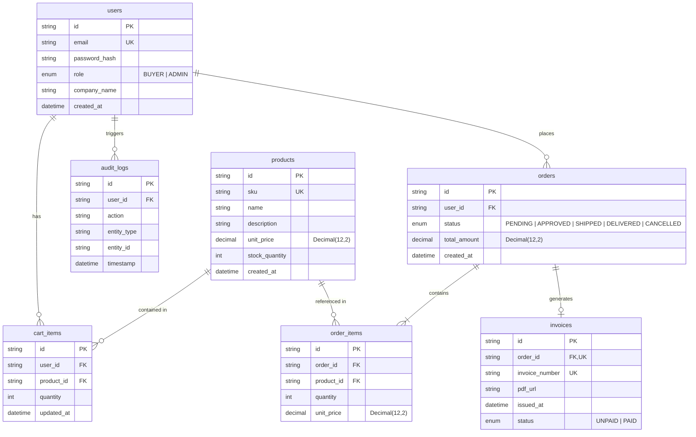

# Arrowstack B2B Order Management Platform

[](https://www.typescriptlang.org/)
[](https://nextjs.org/)
[](https://nestjs.com/)
[](https://www.postgresql.org/)
[](https://www.prisma.io/)
[](https://www.docker.com/)

An enterprise-grade B2B Order Management and Wholesale Inventory Platform built for **Arrowstack Full Stack Development Internship — Task 1**.

The platform provides business buyers with real-time wholesale catalog access, atomic transactional checkout, and order tracking, while providing administrators with live inventory controls, multi-stage fulfillment workflows, automated downloadable PDF invoice generation, and audit logging.

---

## 1. Application Flow & System Architecture

### 1.1 Complete End-to-End Application Flow



---

### 1.2 Checkout Transaction Sequence Diagram



---

### 1.3 Order Fulfillment State Machine



- **Stock Consistency Guarantee**: When an order is placed, stock is atomically reserved (`decrement`). If the order is later `CANCELLED` prior to delivery, the reserved quantities are safely credited back to inventory in a transactional update, and logged in `audit_logs` to prevent double-restocking.
- **Terminal States**: `DELIVERED` and `CANCELLED` orders are immutable to guarantee ledger integrity.

---

### 1.4 End-to-End Operational Workflow

The platform operates through an integrated, 10-step wholesale order and fulfillment workflow:

```mermaid
flowchart LR
    W1[1. Catalog Browsing] --> W2[2. Add to Cart]
    W2 --> W3[3. Cart Calculation]
    W3 --> W4[4. Atomic Checkout]
    W4 --> W5[5. Order Placed]
    W5 --> W6[6. Admin Review]
    W6 --> W7[7. Approval & Invoice]
    W7 --> W8[8. PDF Generation]
    W8 --> W9[9. Dispatch & Shipping]
    W9 --> W10[10. Delivery & Completion]
```



1. **Step 1: Catalog Discovery**: A registered wholesale buyer browses the catalog. Real-time available quantities, SKU identifiers, and tiered unit pricing are retrieved directly from PostgreSQL.
2. **Step 2: Cart Staging**: The buyer selects item quantities. Items are staged in `cart_items` with server-side stock boundary validation (`requested_qty <= stock_quantity`).
3. **Step 3: Server-Side Cart Calculation**: Subtotals and order total are computed purely server-side using PostgreSQL `Decimal` arithmetic. No client-supplied totals or unit prices are trusted.
4. **Step 4: Atomic Checkout Initiation**: The buyer clicks "Place Order", triggering `POST /api/v1/orders`.
5. **Step 5: Transactional Stock Lock & Decrement**: A serializable transaction acquires product locks, decrements inventory atomically, creates historical price snapshots in `order_items`, empties the user's cart, and records an `ORDER_CREATED` audit log.
6. **Step 6: Admin Review & Triage**: The administrator accesses the Admin Console, viewing newly placed pending orders with company details and line-item summaries.
7. **Step 7: Order Approval & State Transition**: Admin changes status from `PENDING` to `APPROVED`. This triggers the creation of an official `Invoice` record with a unique sequential invoice number.
8. **Step 8: Automated PDF Generation**: The platform generates an itemized, printable PDF invoice containing corporate headers, buyer information, timestamp, line items, and totals.
9. **Step 9: Dispatch & Fulfillment**: The order advances to `SHIPPED` as goods leave the warehouse. (If cancelled at any stage prior to delivery, the reserved stock is automatically credited back to inventory in a database transaction).
10. **Step 10: Final Delivery & Ledger Archive**: Admin marks the order `DELIVERED`, reaching the terminal immutable state. Both buyer and admin retain indefinite access to the order history and invoice PDF.

---

### 1.5 Developer & Contributor Workflow



1. **Environment Setup**: Copy `.env.example` to `.env` and specify safe local keys.
2. **Containerized Spin-up**: Execute `docker compose up --build` to automatically spin up PostgreSQL, compile the NestJS API, apply schema migrations, seed demonstration data, and launch the Next.js frontend.
3. **Schema Evolution**: When modifying data models, edit `apps/api/prisma/schema.prisma` and create a migration using `npx prisma migrate dev --name <migration_name>`.
4. **Continuous Verification**: Execute backend tests (`npm test` in `apps/api`) and type-checks (`npm run build` in `apps/web`) before pushing changes.

---

### 1.6 Quality Assurance & Verification Workflow



- **Authentication Guard**: Verifies JWT signature and expiry from HTTP-only cookie on every protected request.
- **Role Guard**: Confirms caller possesses `ADMIN` or `BUYER` claim.
- **Data Isolation Filter**: Injects `userId = req.user.sub` on all buyer queries to strictly prevent Insecure Direct Object References (IDOR).
- **Stock Double-Check**: Verifies atomic decrement condition `stock_quantity >= quantity` within active transaction.
- **Audit Logging**: Logs every state mutation with actor ID, timestamp, and target entity for compliance.

---

### 1.7 Role-Based User Workflows

#### 🛒 Buyer Workflow
1. **Authentication**: Sign in via `POST /api/v1/auth/login` or register with company name via `POST /api/v1/auth/register`. JWT is received in a secure, HTTP-only cookie.
2. **Catalog Discovery**: Live browsing with real-time stock indicators, SKU numbers, wholesale unit pricing, and quantity selection.
3. **Cart Management**: Add items, adjust quantity, or remove items. Subtotal and total amounts are recalculated server-side.
4. **Checkout**: Submits order through a serializable ACID database transaction that reserves stock atomically.
5. **Order History**: Dedicated orders dashboard displaying order timeline, line-item breakdown, and downloadable PDF invoices once approved.

#### 🛡️ Administrator Workflow
1. **Executive Overview**: Real-time KPI metrics (Total Wholesale Revenue, Active Orders, Low-Stock Warnings, Catalog Size).
2. **Inventory Management**: Create new SKUs, modify unit prices and descriptions, adjust stock levels with instant validation.
3. **Order Fulfillment Queue**: Filter and transition orders through `PENDING` $\rightarrow$ `APPROVED` $\rightarrow$ `SHIPPED` $\rightarrow$ `DELIVERED` or `CANCELLED`.
4. **Invoice Generation**: Automated PDF invoice creation with company details, itemized table, totals, and unique invoice numbers.
5. **Audit Trail**: Real-time inspection of administrative and transactional events (who did what, when, and on which entity).

---

## 2. Technology Stack

| Layer | Technology | Purpose |
| :--- | :--- | :--- |
| **Frontend** | **Next.js 15 (App Router)** | Server & Client Components, React 19, TypeScript |
| **Styling** | **Tailwind CSS & Lucide Icons** | B2B SaaS design system, responsive layouts |
| **Backend** | **NestJS 10** | Enterprise modular architecture, Dependency Injection |
| **ORM** | **Prisma 6** | Schema modeling, migrations, type-safe queries |
| **Database** | **PostgreSQL 16** | Relational storage, ACID serializable transactions |
| **Authentication**| **JWT in HTTP-only Cookies** | Stateless sessions, SameSite protection |
| **Authorization** | **RBAC (`@Roles()` Guard)** | Server-side role enforcement (`BUYER`, `ADMIN`) |
| **Invoicing** | **PDFKit & Streaming Service** | Dynamic PDF invoice generation & downloads |
| **DevOps** | **Docker & Docker Compose** | Multi-container orchestration, volume persistence |

---

## 3. Database Schema (Prisma ORM)



---

## 4. API Endpoints Reference (`/api/v1`)

### Authentication (`/api/v1/auth`)
| Method | Endpoint | Access | Description |
| :--- | :--- | :--- | :--- |
| `POST` | `/api/v1/auth/register` | Public | Register buyer with email, password, and company name |
| `POST` | `/api/v1/auth/login` | Public | Authenticate user & set HTTP-only `access_token` cookie |
| `POST` | `/api/v1/auth/logout` | Authenticated | Clear session cookie |
| `GET` | `/api/v1/auth/me` | Authenticated | Retrieve profile and role of authenticated user |

### Products & Inventory (`/api/v1/products`)
| Method | Endpoint | Access | Description |
| :--- | :--- | :--- | :--- |
| `GET` | `/api/v1/products` | Public / Buyer | Browse wholesale catalog with search query |
| `POST` | `/api/v1/products` | Admin | Create a new wholesale product SKU |
| `PATCH`| `/api/v1/products/:id/stock`| Admin | Update available stock quantity |
| `PUT`  | `/api/v1/products/:id` | Admin | Update product details (price, description) |

### Cart (`/api/v1/cart`)
| Method | Endpoint | Access | Description |
| :--- | :--- | :--- | :--- |
| `GET` | `/api/v1/cart` | Buyer | Retrieve active cart with itemized products & subtotals |
| `POST` | `/api/v1/cart/items` | Buyer | Add product to cart or increment quantity |
| `PATCH`| `/api/v1/cart/items/:id` | Buyer | Set specific item quantity in cart |
| `DELETE`| `/api/v1/cart/items/:id` | Buyer | Remove specific line item from cart |
| `DELETE`| `/api/v1/cart` | Buyer | Clear all items from cart |

### Orders & Checkout (`/api/v1/orders`)
| Method | Endpoint | Access | Description |
| :--- | :--- | :--- | :--- |
| `POST` | `/api/v1/orders` | Buyer | Execute transactional checkout with inventory locks |
| `GET` | `/api/v1/orders` | Authenticated | List orders (buyer gets own; admin gets all) |
| `GET` | `/api/v1/orders/:id` | Authenticated | Get detailed order summary with line items |
| `PATCH`| `/api/v1/orders/:id/status`| Admin | Transition order status, trigger invoice/restock |

### Invoices (`/api/v1/invoices`)
| Method | Endpoint | Access | Description |
| :--- | :--- | :--- | :--- |
| `GET` | `/api/v1/invoices/:id` | Authenticated | Fetch invoice metadata (RBAC protected) |
| `GET` | `/api/v1/invoices/:id/pdf` | Authenticated | Download dynamically generated PDF invoice |

### Audit Logs (`/api/v1/audit-logs`)
| Method | Endpoint | Access | Description |
| :--- | :--- | :--- | :--- |
| `GET` | `/api/v1/audit-logs` | Admin | Review immutable system event trail |

### Health Check (`/api/v1/health`)
| Method | Endpoint | Access | Description |
| :--- | :--- | :--- | :--- |
| `GET` | `/api/v1/health` | Public | Service health & PostgreSQL connectivity status |

---

## 5. Demo Accounts

The seed script creates idempotent demonstration accounts:

| Role | Email | Password | Company |
| :--- | :--- | :--- | :--- |
| **Administrator** | `admin@arrowstack.local` | `Admin123!ChangeMe` | Arrowstack Wholesale HQ |
| **Buyer** | `buyer@arrowstack.local` | `Buyer123!ChangeMe` | Demo Retail Co. |

---

## 6. Getting Started & Local Development

### 6.1 Run with Docker Compose (Recommended)
1. Ensure Docker Desktop is installed and running.
2. Copy environment template:
   ```bash
   cp .env.example .env
   ```
3. Start all services:
   ```bash
   docker compose up --build
   ```
4. Access the platforms:
   - **Storefront & Admin UI**: [http://localhost:3000](http://localhost:3000)
   - **REST API**: [http://localhost:4000/api/v1](http://localhost:4000/api/v1)
   - **Health Endpoint**: [http://localhost:4000/api/v1/health](http://localhost:4000/api/v1/health)

### 6.2 Running Locally without Docker
```bash
# 1. Install dependencies
cd apps/api && npm install
cd ../web && npm install

# 2. Setup Database in apps/api/.env
npx prisma migrate dev --name init
npm run seed

# 3. Start Backend
npm run start:dev

# 4. Start Frontend
cd ../web && npm run dev
```

---

## 7. Security Architecture

1. **HTTP-only Cookies**: Authentication tokens are stored in strict HTTP-only, SameSite cookies to mitigate XSS-based token theft.
2. **Server-Side Authorization**: Roles are enforced on the backend via NestJS `JwtGuard` and `RolesGuard`. The frontend UI adaptation is purely navigational and never replaces API authorization.
3. **ACID Transaction Isolation**: Checkouts run under PostgreSQL `Serializable` transactions, validating current stock within the transaction and preventing race conditions or overselling.
4. **Historical Price Snapshots**: `OrderItem` stores historical `unit_price` at the exact second of purchase, insulating past orders from future catalog price edits.
5. **Monetary Precision**: All currency amounts use PostgreSQL `Decimal(12,2)` types, preventing floating-point rounding errors.

---

## 8. Automated Testing & Verification

The platform includes an automated unit and integration test suite executing 29 tests across all business-critical workflows.

### Run All Tests
```bash
# Run from repository root
npm test

# Or run directly in the API service
cd apps/api && npm test
```

### Verified Test Suites & Coverage
- **`auth.service.spec.ts`**: Buyer registration, bcrypt password hashing (salt rounds 12), duplicate email conflict prevention, credential verification, and generic error messaging.
- **`products.service.spec.ts`**: Catalog listing, case-insensitive multi-field search, unique SKU validation, positive unit price checks, non-negative stock validation, and admin stock updates.
- **`cart.service.spec.ts`**: Item staging, live inventory quota validation, server-side Decimal total calculation, item quantity direct updates, and cart deletion.
- **`orders.service.spec.ts`**:
  - Empty cart rejection.
  - Serializable ACID transaction checkout with atomic stock decrement.
  - Transaction rollback on inventory race conditions.
  - Automatic inventory restock on order cancellation.
  - Prohibition of modifications to terminal orders (`DELIVERED`, `CANCELLED`).
  - Strict IDOR cross-company invoice access prevention.
  - Dynamic PDF generation and streaming buffer generation.

---

## 9. Monorepo Folder Structure

```
arrowstack-b2b-order-platform/
├── .env.example                     # Environment configuration template
├── README.md                        # Master platform documentation & application flow
├── docker-compose.yml               # Multi-container orchestration (db, api, web)
├── package.json                     # Monorepo scripts (build, test, seed)
├── apps/
│   ├── api/                         # NestJS Backend API Service
│   │   ├── Dockerfile               # Multi-stage production container
│   │   ├── package.json             # Backend dependencies & Jest configuration
│   │   ├── tsconfig.json            # Backend TypeScript configuration
│   │   ├── prisma/
│   │   │   ├── schema.prisma        # PostgreSQL relational data models
│   │   │   ├── seed.ts              # Idempotent wholesale demonstration data
│   │   │   └── migrations/          # Version-controlled schema migrations
│   │   └── src/
│   │       ├── main.ts              # Global pipes, Swagger docs (/api/docs), CORS
│   │       ├── app.module.ts        # Root NestJS dependency injection module
│   │       ├── security.ts          # JwtGuard, RolesGuard, and @Roles() decorator
│   │       ├── prisma.service.ts    # Prisma lifecycle client hook
│   │       ├── pdf.service.ts       # PDFKit dynamic invoice generation engine
│   │       ├── auth.*               # Authentication controller, service & DTOs
│   │       ├── products.*           # Product catalog controller, service & DTOs
│   │       ├── cart.*               # Cart controller, service & DTOs
│   │       ├── orders.*             # ACID checkout & invoice controller & service
│   │       ├── audit-logs.*         # Compliance audit log controller & service
│   │       └── health.controller.ts # Service & database health probe
│   └── web/                         # Next.js 15 App Router Frontend
│       ├── Dockerfile               # Production web container
│       ├── package.json             # Frontend dependencies & Next.js scripts
│       ├── tailwind.config.ts       # Tailwind CSS design system & elevation tokens
│       └── app/
│           ├── layout.tsx           # Global HTML metadata & root shell
│           ├── globals.css          # CSS custom variables & subtle animations
│           └── page.tsx             # Enterprise B2B SaaS interactive dashboard
└── docs/
    └── video/                       # LinkedIn Video Showcase Package
        ├── storyboard.md            # Detailed timestamped storyboard
        ├── narration.md             # Verbatim voiceover script
        ├── recording-checklist.md   # Recording environment and rehearsal checklist
        ├── shot-list.md             # Visual camera angles & overlay graphics
        └── linkedin-post.md         # Professional LinkedIn post draft
```

---

## 10. Troubleshooting & Common Issues

| Issue | Cause | Solution |
| :--- | :--- | :--- |
| **`failed to connect to docker API`** | Docker Desktop engine is not running on host | Start Docker Desktop from the Start Menu or Applications folder before running `docker compose`. |
| **`P1001: Can't reach database server`** | Database container is still initializing | The Compose configuration includes an automatic `service_healthy` check. Allow up to 10 seconds for PostgreSQL to accept connections. |
| **`Insufficient stock available for SKU`** | Requested item quantity exceeds warehouse quota | Check available units in the catalog or adjust stock via the Admin Console. |
| **`Terminal order status cannot be modified`** | Attempting to change a `DELIVERED` or `CANCELLED` order | Completed orders are immutable in the ledger to preserve financial audit integrity. |
| **`CORS origin error`** | Frontend running on non-whitelisted port | Ensure `WEB_ORIGIN=http://localhost:3000` is configured in `.env`. |

---

## 11. LinkedIn Showcase Package

To review the complete video presentation and public demonstration materials prepared for this internship task, explore the `docs/video/` directory:
- [Storyboard](docs/video/storyboard.md): Complete scene-by-scene script with visual cues.
- [Narration Script](docs/video/narration.md): Voiceover transcript formatted for clear 75–90s delivery.
- [Recording Checklist](docs/video/recording-checklist.md): Step-by-step recording rehearsal instructions.
- [Shot List](docs/video/shot-list.md): Granular camera angles, cursor movements, and on-screen graphics.
- [LinkedIn Post Draft](docs/video/linkedin-post.md): Production-ready post draft highlighting key engineering takeaways.

